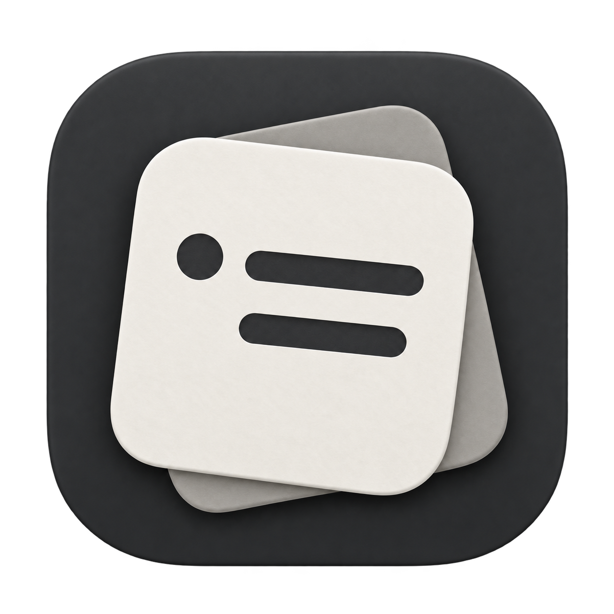

# DevNotes

A minimal note-taking app for Mac. Keep ideas, code snippets, and tasks together — no account or cloud required.

## Features

- Text, code, checklists, images, and tables in a single note.
- Search, pinned notes, and colorful labels.
- Reminders and on-device voice dictation in Russian.
- Table export to CSV and Excel.
- Autosave and a trash folder for restoring deleted notes.
- Light and dark themes.

Notes are encrypted and stored locally on your Mac. Choose how to unlock the app: Touch ID only, Touch ID or your Mac password, or no app lock.

## Download and Install

Requires **macOS 14 or later**. Supports Apple Silicon and Intel Macs.

1. Download the `.dmg` from the latest release in this repository's **Releases** section.
2. Open it and drag **DevNotes** into **Applications**.
3. Launch the app.

The app is not yet notarized by Apple. If macOS blocks it, try opening it once, then go to **System Settings → Privacy & Security → Open Anyway**.

Allow microphone and speech recognition access to use dictation, and notifications to receive reminders. Dictation requires on-device Russian speech recognition support on your Mac.

## Built With

Swift · SwiftUI · AppKit · CryptoKit · Speech · LocalAuthentication

[Build instructions and technical details (in Russian)](docs/TECHNICAL.md).
